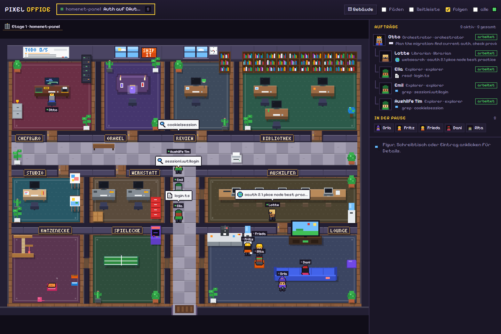
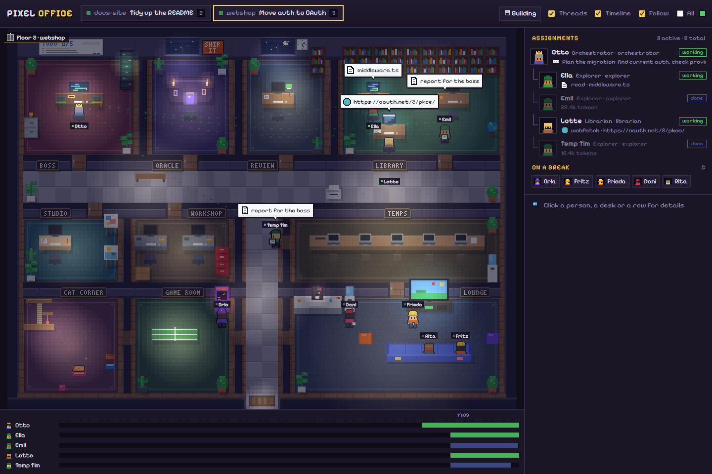
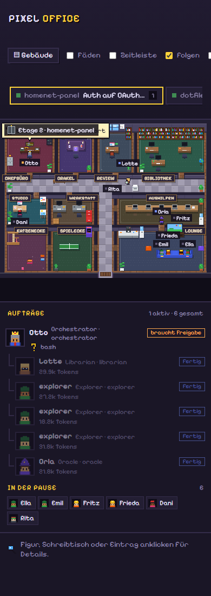
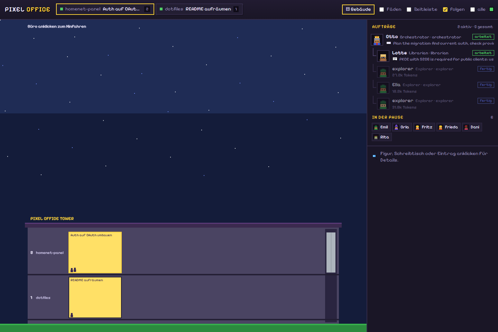
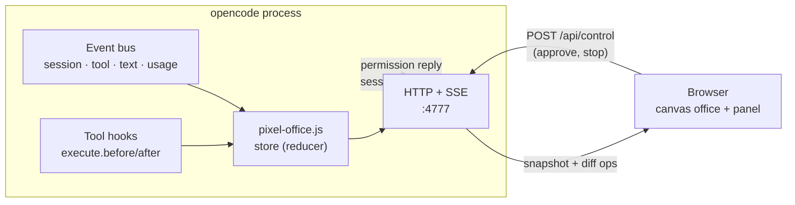

<div align="center">

# 🏢 opencode Pixel Office

**Watch your opencode orchestrator and its subagents work live – in a top-down pixel-art office.**

An opencode plugin that starts a tiny web server inside the opencode process and turns every session, tool call and
delegation into office life: the boss hands out assignments on paper, the team works at their desks, and whoever
has nothing to do takes a break in the lounge.




</div>

---

## Contents

- [Features](#-features)
- [Screenshots](#-screenshots)
- [Quick start](#-quick-start)
- [Installation](#-installation)
- [Configuration](#-configuration)
- [Using the UI](#-using-the-ui)
- [The office](#-the-office)
- [Approvals & security](#-approvals--security)
- [How it works](#-how-it-works)
- [Troubleshooting](#-troubleshooting)
- [Limitations](#-limitations)
- [Development](#-development)
- [Changelog](#-changelog)
- [Licenses](#-licenses)

## ✨ Features

| | |
|---|---|
| 👥 **A permanent team with names** | Otto (boss), Ella & Emil (explorers), Lotte (librarian), Orla (oracle), Fritz & Frieda (fixers), Dani (designer), Rita (reviewer) – each with their own desk. When a team is busy, a temp walks in and works on a laptop. |
| 📄 **Paperwork** | Pick up the assignment from the boss's outbox → work on it at the desk (every file edit adds a page to the stack) → bring the report back to the inbox. |
| 💬 **Live speech bubbles** | The current tool with a pixel icon (read, edit, bash, grep, web, task …), streamed text and reasoning. Monitors show code, a terminal or a browser. |
| ☕ **Breaks** | Off-duty staff grab a coffee, watch TV, chill on a beanbag, play arcade games or ping-pong, check their phone, browse the web or pet the office cat. |
| ✋ **Approvals in the UI** | Answer permission requests with *Allow once / Always allow / Reject* and stop running agents. |
| 🔎 **Needs attention** | One queue across all rooms: approvals and questions, unresolved failures and agents with no activity for 10 minutes. |
| 🧵 **Threads & timeline** | Who delegated to whom, plus working / waiting / retrying / idle / failed intervals with work and wait totals. |
| 🏢 **Building** | One floor per project folder, one office per session, an elevator in between. |
| 🌙 **Day & night** | Follows your local time; at night lit by monitors, lamps and a crystal ball. |
| 📱 **Anywhere** | Desktop and phone, local or across your LAN/Tailscale (with a token). |
| 📦 **One file** | A single self-contained `pixel-office.js` with zero runtime dependencies – no assets, CDNs or external calls. |

## 📸 Screenshots

<table>
  <tr>
    <td width="66%"></td>
    <td width="34%" rowspan="2"></td>
  </tr>
  <tr>
    <td></td>
  </tr>
  <tr>
    <td><sub>At night with the timeline and a pending approval in <i>Needs attention</i> · below: the building with one floor per project</sub></td>
    <td><sub>Phone view</sub></td>
  </tr>
</table>

## ⚡ Quick start

```bash
git clone https://github.com/gingerthighs/opencode-pixel-office.git
cd opencode-pixel-office
./install.sh          # Windows: .\install.ps1
```

Start opencode, run a task, open **http://127.0.0.1:4777/**.

Just want to look around first? `npm install && npm run mock` plays a demo scenario without opencode.

## 🚀 Installation

### Requirements

| | |
|---|---|
| **opencode** | 1.x or 2.x. Works with plain opencode; shines with [oh-my-opencode](https://github.com/code-yeongyu/oh-my-opencode) or oh-my-opencode-slim, which spawn subagents. |
| **Node.js ≥ 22.18** | Only to **build** the plugin (it runs TypeScript directly). At runtime the plugin uses opencode's own runtime. |
| **Browser** | Any current desktop or mobile browser. |

### Install script

<details open>
<summary><b>🍎 macOS · 🐧 Linux · WSL</b></summary>

```bash
./install.sh
```
</details>

<details open>
<summary><b>🪟 Windows (PowerShell)</b></summary>

```powershell
.\install.ps1
```

If the execution policy blocks the script:

```powershell
powershell -ExecutionPolicy Bypass -File .\install.ps1
```
</details>

The script installs the build dependencies, builds `dist/pixel-office.js` and copies it to
`~/.config/opencode/plugins/` (Windows: `%USERPROFILE%\.config\opencode\plugins\`). opencode 2.x picks it up while
running; with 1.x restart opencode once.

| Option | Effect |
|---|---|
| `--host 0.0.0.0` | make it reachable on your LAN / via Tailscale |
| `--token auto` | require a token (generated and printed) – always use it together with `0.0.0.0` |
| `--port 4800` | use a different port (default `4777`) |
| `--project <dir>` | install for one project only (`<dir>/.opencode/plugins`) |
| `--skip-build` | use the existing `dist/pixel-office.js` |
| `--uninstall [--purge]` | remove the plugin (`--purge` also deletes `pixel-office.json`) |

Options for host, port and token are saved to `pixel-office.json` and kept on later runs. Example for a server on
your home network:

```bash
./install.sh --host 0.0.0.0 --token auto
```

### Update

```bash
git pull
./install.sh          # Windows: .\install.ps1
```

opencode 2.x hot-reloads the new file; open browser tabs reconnect on their own.

### Uninstall

```bash
./install.sh --uninstall --purge
```

<details>
<summary>Manual installation (no Node.js needed with the release file)</summary>

Download `pixel-office.js` from the [latest release](https://github.com/gingerthighs/opencode-pixel-office/releases/latest)
and copy it to `~/.config/opencode/plugins/`. Settings go into `~/.config/opencode/pixel-office.json` (see
[Configuration](#-configuration)). Or build it yourself:

```bash
npm ci && npm run build
cp dist/pixel-office.js ~/.config/opencode/plugins/pixel-office.js
```
</details>

## 🔧 Configuration

Settings are read in this order (first one wins):

1. Environment variables of the opencode process
2. Plugin options, when the plugin is listed in `opencode.json`: `"plugin": [["<path or package>", { "port": 4777 }]]`
3. `~/.config/opencode/pixel-office.json` – written by the installer
4. Defaults

| Setting | Env variable | Default | |
|---|---|---|---|
| `port` | `PIXEL_OFFICE_PORT` | `4777` | |
| `host` | `PIXEL_OFFICE_HOST` | `127.0.0.1` | `0.0.0.0` for LAN / Tailscale |
| `token` | `PIXEL_OFFICE_TOKEN` | – | open the URL once with `?token=…`, the browser keeps it in a cookie |
| `allowedHosts` | `PIXEL_OFFICE_ALLOWED_HOSTS` | `[]` | host names allowed without a token (e.g. `box.tail1234.ts.net`); `localhost` and IP addresses always work. Env: comma-separated |
| `debug` | `PIXEL_OFFICE_DEBUG` | `false` | write event samples to `pixel-office-events.jsonl` for diagnosis (see [Troubleshooting](#-troubleshooting)) |

```json
{ "port": 4777, "host": "0.0.0.0", "token": "your-secret-token" }
```

> [!TIP]
> opencode 2.x starts a **background service** (`opencode serve --service`) that loads the plugins. Environment
> variables you set after it started never reach it – that is what `pixel-office.json` is for.

## 🖱 Using the UI

| Control | What it does |
|---|---|
| **Room tabs** | One tab per session (main session + its subagents). Rooms idle for more than two hours are hidden. |
| **Needs attention** | Queue across all rooms. Click an entry to jump to the room and open the details. |
| **▤ Building** | Overview with one floor per project folder; click an office to ride the elevator there. |
| **Threads** | Lines from the boss to everyone working on one of their assignments. |
| **Timeline** | Activity per agent below the office, with 15-, 60- or 120-minute windows. |
| **Follow** | Stay on the current room while it's busy, then jump to the most recently active busy room. |
| **All** | Also show rooms that went quiet. |
| **Panel** | Click a person, desk or row for the activity feed, todos, edited files, tokens and controls. |

URL parameters for links or a second screen: `?time=day|night`, `?threads=1`, `?timeline=1`, `?follow=0`,
`?view=building`.

### Needs attention

Ordered by urgency – approvals and questions first, then unresolved failures, then busy agents with no observed
activity for 10 minutes – and oldest first within each group. "No activity" only means no events arrived; it does
not prove an agent is stuck. New activity clears an entry, a new run clears a failure. While the browser is
disconnected a warning is shown and the inactivity check pauses. On phones the queue starts collapsed.

### Timeline and history

The timeline shows what the server **observed**: history starts when a session is first seen, earlier work is not
guessed. Finished agents leave the office after 60 seconds but stay in the timeline; click their row for read-only
details.

History is kept **in memory only** – up to two hours, 1,000 finished sessions and 10,000 intervals, oldest first
out (the UI marks truncated history). Reloading the page keeps it; restarting opencode or reloading the plugin
clears it; deleting a session removes its record. Nothing is written to disk.

## 🗺 The office

```
┌──────────┬────────┬────────┬──────────────────┐
│   BOSS   │ ORACLE │ REVIEW │     LIBRARY      │
│   Otto   │  Orla  │  Rita  │ Ella·Emil·Lotte  │
├──────────┴────────┴────────┴──────────────────┤
│                    HALLWAY                    │
├───────────┬─────────────┬──┬──────────────────┤
│  STUDIO   │  WORKSHOP   │  │      TEMPS       │
│   Dani    │ Fritz·Frieda│  │    (laptops)     │
├───────────┼─────────────┤  ├──────────────────┤
│   CAT     │    GAME     │  │      LOUNGE      │
│  CORNER   │    ROOM     │  │ TV·sofa·kitchen  │
└───────────┴─────────────┴──┴──────────────────┘
                        entrance
```

| Agent (opencode / oh-my-opencode) | Team | Room |
|---|---|---|
| `orchestrator`, `sisyphus`, `atlas`, `hephaestus`, `prometheus`, `build`, `plan` | Boss | Boss office |
| `explorer`, `explore`, `general` | Explorer | Library |
| `librarian` | Librarian | Library |
| `oracle`, `metis`, `momus`, `council` | Oracle | Oracle room |
| `fixer`, `sisyphus-junior` | Fixer | Workshop |
| `designer`, `frontend-ui-ux-engineer`, `multimodal-looker`, `document-writer` | Designer | Studio |
| `reviewer`, `observer` | Reviewer | Review |
| anything else, or when the team is busy | Temp | Temps room |

Otto always takes the main session of a room. Subagents go to the matching free team member.

## 🔐 Approvals & security

> [!IMPORTANT]
> The UI shows prompts, file names and commands. By default it only listens on **`127.0.0.1`**. If you bind to
> `0.0.0.0`, always set a `token` (or only expose it through Tailscale/a VPN).

- **DNS-rebinding protection:** without a token the server only answers requests for `localhost`, IP addresses and
  names in `allowedHosts`. A malicious page that points its own domain at `127.0.0.1` gets `421`.
- **Controls** (approvals, stop) go through `POST /api/control` and need:
  - a per-process nonce from the same-origin capabilities endpoint (refreshed after reconnects),
  - without a token: a loopback bind and a `localhost` Host header,
  - over the network: the token.
- **Event forwarding** (`POST /api/ingest`, between opencode processes) needs a custom header that browsers can't
  send cross-site, because the CORS preflight is never approved.
- **Forwarded controls** go back to the process that owns the session through a private loopback listener with a
  random per-process token. Its credentials never appear in UI snapshots.
- **Token file:** the installer writes `pixel-office.json` with mode `600` (readable by you only).
- **No third parties:** the font is embedded and the page loads nothing from other servers (strict CSP).
- **Debug sampling** is off by default (see [Troubleshooting](#-troubleshooting)).

Found a security issue? Please report it privately via
[GitHub security advisories](https://github.com/gingerthighs/opencode-pixel-office/security/advisories/new)
instead of opening a public issue.

## 🧩 How it works



- **One file, zero dependencies:** `build.ts` bundles the UI, the font and the server with esbuild into
  `dist/pixel-office.js`. The server uses `node:http`, which works in Bun and Node.
- **opencode 1.x and 2.x:** classic hooks (`server` → `event`) and the new `setup(ctx)` API; `src/v2.ts` translates
  v2 events (`session.execution.*`, `session.tool.*`, `session.text/reasoning.*`, `form.*` …).
- **Subagents** are child sessions with a `parentID`; sessions revived via `task_revive` are looked up once with
  `ctx.session.get`.
- **Several opencode processes:** the first one owns the port, the others forward their events via
  `POST /api/ingest`. Failed batches retry in order with bounded backoff (backlog of up to 5,000 events). Approvals
  and stop requests are routed back to the process that owns the session.
- **Hot reload:** when the plugin file changes, the new version takes over from the old server.

## 🩺 Troubleshooting

<details>
<summary><b>The page doesn't load</b></summary>

- Is opencode running? opencode unloads plugins when no instance has been active for a while – opening the CLI is
  enough.
- Check the log: search `~/.local/share/opencode/log/` for `pixel-office` (e.g. "failed to load plugin" or
  "Port … is taken").
</details>

<details>
<summary><b>"Host not allowed" (421)</b></summary>

You opened the UI through a host name without a token. Use `localhost`/the IP address, add the name to
`allowedHosts`, or set a `token`.
</details>

<details>
<summary><b>"Token required"</b></summary>

Open the URL once with `?token=<your token>`; the browser stores it in a cookie. The installer prints the full URL,
and the token is in `~/.config/opencode/pixel-office.json`.
</details>

<details>
<summary><b>Approve / Stop buttons are missing</b></summary>

Controls only work on a loopback bind opened via `localhost`/`127.0.0.1`, or with a token. The panel shows the reason
("Controls off: …"). Questions (pick an option) are always answered in the terminal.
</details>

<details>
<summary><b>Port already in use</b></summary>

Another opencode process already owns the port – that's intended, events are forwarded there. For a different
port: `./install.sh --port 4800`.
</details>

<details>
<summary><b>Settings don't apply</b></summary>

Use `pixel-office.json` instead of environment variables (`./install.sh --host … --token …`). opencode's background
service doesn't see variables set after it started.
</details>

<details>
<summary><b>Inspecting events</b></summary>

With `PIXEL_OFFICE_DEBUG=1` (or `"debug": true` in `pixel-office.json`) the first samples of each event type are
written to `~/.local/share/opencode/log/pixel-office-events.jsonl`. Texts are shortened but still contain snippets
of prompts and commands – so this is off by default, the file is readable by you only and capped at 256 KB.
</details>

## 🚧 Limitations

- **Questions** (an agent asking you to pick an option) are shown, but must be answered in the terminal – opencode's
  plugin API cannot send answers.
- **History** lives in memory and is lost when opencode restarts or the plugin reloads.
- **Early history:** sessions that ran before the plugin loaded show up, but their past activity is unknown.
- **Not on npm yet** – use the install scripts or the file from the releases page.

## 🛠 Development

```bash
npm install
npm run mock        # demo without opencode: http://127.0.0.1:4777 (MOCK_SPEED=1 for fast, PIXEL_OFFICE_PORT to change)
npm test            # builds first; reducer, adapters, forwarding, controls, activity, UI, server protection
npm run typecheck
npm run build       # → dist/pixel-office.js
```

Bug reports and pull requests are welcome. Please run `npm test` and `npm run typecheck` before opening a PR.

<details>
<summary>Project layout</summary>

```
src/
  plugin.ts    plugin entry (default export { id, server, setup }), singleton, host adapters
  instance.ts  session ownership, snapshots, forwarding retries, control routing
  store.ts     pure reducer: opencode events → UI ops, activity history
  v2.ts        opencode 2.x adapter: v2 events + tool hooks → v1 events
  server.ts    node:http – /, /app.js, /api/state, /api/events (SSE), /api/ingest, /api/control, /api/caps
  config.ts    env / options / pixel-office.json
web/
  office.ts      floor plan, walls, furniture, lights, pathfinding
  characters.ts  staff (assignment workflow, breaks) + the office cat
  scene.ts       rendering, staffing, threads, building, overlays
  controls.ts    capabilities, nonce, control requests
  activity.ts    interval clipping, totals, attention ordering
  attention.ts   attention queue and connection warning
  dom.ts         stable panel/queue/timeline updates
  panel.ts · timeline.ts · sprites.ts · bubbles.ts · roles.ts · state.ts · main.ts
  fonts/         Pixelify Sans (OFL), inlined at build time
scripts/
  install.ts   cross-platform installer (called by install.sh / install.ps1)
  mock.ts      demo scenario
test/          node:test suites (npm test)
```
</details>

## 📝 Changelog

See [CHANGELOG.md](CHANGELOG.md).

## 📜 Licenses

- Code: [MIT](LICENSE) © gingerthighs
- Font: [Pixelify Sans](https://github.com/eifetx/Pixelify-Sans) under the SIL Open Font License 1.1
  (`web/fonts/OFL.txt`).
- All graphics are drawn procedurally in code – no third-party sprites.
- Not affiliated with the opencode or oh-my-opencode projects.
