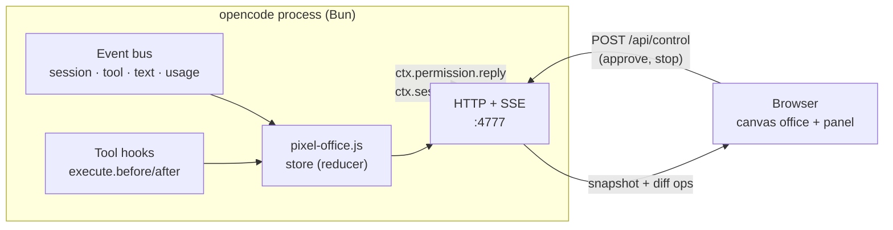

<div align="center">

# 🏢 opencode Pixel Office

**Watch your opencode orchestrator and its subagents work live – in a top-down pixel-art office.**

An opencode plugin that starts a tiny web server in the same process and turns every session, tool call and
delegation into office life: the boss hands out assignments on paper, the team works at their desks, and whoever
has nothing to do takes a break in the lounge.


</div>

---

## Contents

- [Features](#-features)
- [Screenshots](#-screenshots)
- [Installation](#-installation)
- [Configuration](#-configuration)
- [The office](#-the-office)
- [Approvals & security](#-approvals--security)
- [How it works](#-how-it-works)
- [Troubleshooting](#-troubleshooting)
- [Development](#-development)
- [Licenses](#-licenses)

## ✨ Features

| | |
|---|---|
| 👥 **A permanent team with names** | Otto (boss), Ella & Emil (explorers), Lotte (librarian), Orla (oracle), Fritz & Frieda (fixers), Dani (designer), Rita (reviewer) – each with their own desk. When a team is busy, a temp walks in through the door and works on a laptop. |
| 📄 **Paperwork** | Pick up the assignment from the boss's outbox → work on it at the desk (every file edit adds a page to the stack) → bring the report back to the inbox. |
| 💬 **Live speech bubbles** | The current tool with a pixel icon (read, edit, bash, grep, web, task …), streamed text and reasoning. Monitors show code, a terminal or a browser. |
| ☕ **Breaks** | Off-duty staff grab a coffee, watch TV, chill on a beanbag, play arcade games or ping-pong, check their phone, browse the web or pet the office cat. |
| ✋ **Approvals in the UI** | Answer permission requests with *Allow once / Always allow / Reject* and stop running agents. |
| 🧵 **Threads & timeline** | Who delegated to whom, who worked when and for how long in parallel. |
| 🏢 **Building** | One floor per project folder, one office per session, an elevator in between. |
| 🌙 **Day & night** | Follows your local time; at night lit by monitors, lamps and a crystal ball. |
| 📱 **Anywhere** | Desktop and phone, local or across your LAN/Tailscale (with a token). |

## 📸 Screenshots

<table>
  <tr>
    <td width="66%"></td>
    <td width="34%" rowspan="2"></td>
  </tr>
  <tr>
    <td></td>
  </tr>
  <tr>
    <td><sub>At night with threads (who delegated to whom) and the timeline · below: the building with one floor per project</sub></td>
    <td><sub>Phone view</sub></td>
  </tr>
</table>

## 🚀 Installation

To **build** the plugin you need [Node.js](https://nodejs.org) ≥ 22.18 (it runs TypeScript directly). At runtime
the plugin uses opencode's own Bun runtime – nothing else is required there.

```bash
git clone https://github.com/gingerthighs/opencode-pixel-office.git
cd opencode-pixel-office
```

<details open>
<summary><b>🍎 macOS · 🐧 Linux · WSL</b></summary>

```bash
./install.sh
```
</details>

<details open>
<summary><b>🪟 Windows (PowerShell)</b></summary>

```powershell
.\install.ps1
```

If the execution policy blocks the script:

```powershell
powershell -ExecutionPolicy Bypass -File .\install.ps1
```
</details>

The script installs the build dependencies, builds `dist/pixel-office.js` and copies it to
`~/.config/opencode/plugins/` (Windows: `%USERPROFILE%\.config\opencode\plugins\`). opencode 2.x loads it right
away; with 1.x restart opencode once. Then open:

> **http://127.0.0.1:4777/**

### Options

| Option | Effect |
|---|---|
| `--host 0.0.0.0` | make it reachable on your LAN / via Tailscale |
| `--token auto` | require a token (generated and printed) – mandatory when you use `0.0.0.0` |
| `--port 4800` | use a different port |
| `--project <dir>` | install for one project only (`<dir>/.opencode/plugins`) |
| `--skip-build` | use the existing `dist/pixel-office.js` |
| `--uninstall [--purge]` | remove the plugin (`--purge` also removes the settings) |

Example for a server on your home network:

```bash
./install.sh --host 0.0.0.0 --token auto
```

<details>
<summary>Manual installation</summary>

```bash
npm ci && npm run build
cp dist/pixel-office.js ~/.config/opencode/plugins/pixel-office.js
```
</details>

## 🔧 Configuration

Settings are read in this order (first one wins):

1. Environment variables of the opencode process
2. Plugin options in `opencode.json`: `"plugin": [["opencode-pixel-office", { "port": 4777 }]]`
3. `~/.config/opencode/pixel-office.json` – written by the installer
4. Defaults

| Setting | Env variable | Default | |
|---|---|---|---|
| `port` | `PIXEL_OFFICE_PORT` | `4777` | |
| `host` | `PIXEL_OFFICE_HOST` | `127.0.0.1` | `0.0.0.0` for LAN / Tailscale |
| `token` | `PIXEL_OFFICE_TOKEN` | – | open the URL once with `?token=…`, the browser keeps it in a cookie |
| `allowedHosts` | `PIXEL_OFFICE_ALLOWED_HOSTS` | `[]` | host names allowed without a token (e.g. `box.tail1234.ts.net`); `localhost` and IP addresses always work |
| `debug` | `PIXEL_OFFICE_DEBUG` | `false` | write event samples to the opencode log for diagnosis |

```json
{ "port": 4777, "host": "0.0.0.0", "token": "your-secret-token" }
```

> [!TIP]
> opencode 2.x starts a **background service** (`opencode serve --service`) that loads the plugins. Environment
> variables you set after it started never reach it – that is what `pixel-office.json` is for.

### URL parameters

Handy for links or a second screen: `?time=day|night`, `?threads=1`, `?timeline=1`, `?follow=0`, `?view=building`.

## 🗺 The office

```
┌──────────┬────────┬────────┬──────────────────┐
│   BOSS   │ ORACLE │ REVIEW │     LIBRARY      │
│   Otto   │  Orla  │  Rita  │ Ella·Emil·Lotte  │
├──────────┴────────┴────────┴──────────────────┤
│                    HALLWAY                    │
├───────────┬─────────────┬──┬──────────────────┤
│  STUDIO   │  WORKSHOP   │  │      TEMPS       │
│   Dani    │ Fritz·Frieda│  │    (laptops)     │
├───────────┼─────────────┤  ├──────────────────┤
│   CAT     │    GAME     │  │      LOUNGE      │
│  CORNER   │    ROOM     │  │ TV·sofa·kitchen  │
└───────────┴─────────────┴──┴──────────────────┘
                        entrance
```

| Agent (opencode / oh-my-opencode) | Team | Room |
|---|---|---|
| `orchestrator`, `sisyphus`, `atlas`, `build`, `plan`, `prometheus` | Boss | Boss office |
| `explorer`, `explore`, `general` | Explorer | Library |
| `librarian` | Librarian | Library |
| `oracle`, `metis`, `momus`, `council` | Oracle | Oracle room |
| `fixer`, `sisyphus-junior` | Fixer | Workshop |
| `designer`, `frontend-ui-ux-engineer`, `multimodal-looker`, `document-writer` | Designer | Studio |
| `reviewer`, `observer` | Reviewer | Review |
| anything else / when busy | Temp | Temps room |

Otto always takes the main session of a room. Subagents go to the matching free team member.

## 🔐 Approvals & security

- The UI shows prompts, file names and commands. By default it listens **on `127.0.0.1` only**.
- With `host: 0.0.0.0` always set a `token` (or only run it behind Tailscale/a VPN).
- **DNS-rebinding protection:** without a token the server only answers requests for `localhost`, IP addresses and
  names in `allowedHosts`. A malicious page that points its own domain at `127.0.0.1` gets `421`.
- **Controls** (answering approvals, stop) go through `POST /api/control`:
  - they need a nonce read from the same-origin capabilities endpoint; it refreshes after reconnects,
  - without a token only on a loopback bind with a `localhost` Host header,
  - over the network only with a token.
- **Event forwarding** (`POST /api/ingest`, between opencode processes) needs a custom header; browsers can't send
  it cross-site without a CORS approval, which is never given.
- **Forwarded controls** return to the process that owns the session through a private loopback listener,
  protected by a random per-process token and a custom header. Its credentials never appear in UI snapshots.
- **Token file:** the installer creates `pixel-office.json` with mode `600` (readable by you only).
- **No third parties:** the font is embedded, the page loads nothing from other servers.
- **Questions** (an agent asking you to pick an option) are shown but answered in the terminal – opencode's plugin
  API cannot send answers.

## 🧩 How it works



- **One file, zero dependencies:** `build.ts` bundles the UI, the font and the server with esbuild into `dist/pixel-office.js`.
- **opencode 1.x and 2.x:** classic hooks (`server` → `event`) and the new `setup(ctx)` API; `src/v2.ts` translates
  v2 events (`session.execution.*`, `session.tool.*`, `session.text/reasoning.*`, `form.*` …).
- **Subagents** are child sessions with a `parentID`; sessions revived via `task_revive` are looked up once with
  `ctx.session.get`.
- **Several opencode processes:** the first one owns the port, the others forward their events via `POST /api/ingest`.
  Failed batches retry in order with bounded backoff; the backlog keeps up to 5,000 queued events and logs overflow.
  Approval and stop requests route back to the session's owner; host errors are reported in the UI.
- **Hot reload:** when the plugin file changes, the new version takes over from the old server.

## 🩺 Troubleshooting

<details>
<summary><b>The page doesn't load</b></summary>

- Is opencode running? opencode unloads plugins when no instance has been active for a while – opening the CLI is enough.
- Check the log: search `~/.local/share/opencode/log/opencode.log` for `pixel-office`
  (e.g. "failed to load plugin" or "Port … is taken").
</details>

<details>
<summary><b>"Host not allowed" (421)</b></summary>

You opened the UI through a host name without a token. Use `localhost`/the IP address, add the name to
`allowedHosts`, or set a `token`.
</details>

<details>
<summary><b>Port already in use</b></summary>

Another opencode process already owns the port – that's intended, events are forwarded there.
For a different port: `./install.sh --port 4800`.
</details>

<details>
<summary><b>Settings don't apply</b></summary>

Use `pixel-office.json` instead of environment variables (`./install.sh --host … --token …`). opencode's background
service doesn't see variables set after it started.
</details>

<details>
<summary><b>Inspecting events</b></summary>

With `PIXEL_OFFICE_DEBUG=1` (or `"debug": true` in `pixel-office.json`) the first two samples of each event type are
written to `~/.local/share/opencode/log/pixel-office-events.jsonl`. Texts are shortened but still contain snippets of
prompts and commands – so this is off by default, the file is readable by you only and capped at 256 KB.
</details>

## 🛠 Development

```bash
npm install
npm run mock        # demo without opencode: http://127.0.0.1:4777 (MOCK_SPEED=1 for fast)
npm test            # builds first; reducer, adapters, forwarding, controls, UI regressions, server protection
npm run typecheck
npm run build       # → dist/pixel-office.js
```

<details>
<summary>Project layout</summary>

```
src/
  plugin.ts    plugin entry (default export { id, server, setup }), singleton, host adapters
  instance.ts  session ownership, snapshots, forwarding retries, control routing
  store.ts     pure reducer: opencode events → UI ops
  v2.ts        opencode 2.x adapter: v2 events + tool hooks → v1 events
  server.ts    node:http – /, /app.js, /api/state, /api/events (SSE), /api/ingest, /api/control, /api/caps
  config.ts    env / options / pixel-office.json
web/
  office.ts      floor plan, walls, furniture, lights, pathfinding
  characters.ts  staff (assignment workflow, breaks) + the office cat
  scene.ts       rendering, staffing, threads, building, overlays
  controls.ts    refreshed capabilities and nonce, control requests
  panel.ts · timeline.ts · sprites.ts · bubbles.ts · roles.ts · state.ts · main.ts
  fonts/         Pixelify Sans (OFL), inlined at build time
scripts/
  install.ts   cross-platform installer (called by install.sh / install.ps1)
  mock.ts      demo scenario
```
</details>

## 📜 Licenses

- Code: [MIT](LICENSE) © gingerthighs
- Font: [Pixelify Sans](https://github.com/eifetx/Pixelify-Sans) under the SIL Open Font License 1.1
  (`web/fonts/OFL.txt`).
- All graphics are drawn procedurally in code – no third-party sprites.
