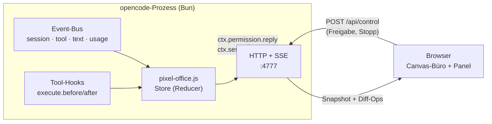

<div align="center">

# 🏢 opencode Pixel Office

**Schau deinem opencode-Orchestrator und seinen Subagents live bei der Arbeit zu – in einem Pixel-Art-Büro von oben.**

Ein opencode-Plugin, das im selben Prozess einen kleinen Webserver startet und jede Session, jedes Tool und jede
Delegation als Büroalltag darstellt: Der Chef verteilt Aufträge auf Papier, das Team arbeitet an seinen Schreibtischen,
und wer nichts zu tun hat, macht Pause in der Lounge.


</div>

---

## Inhalt

- [Features](#-features)
- [Screenshots](#-screenshots)
- [Installation](#-installation)
- [Konfiguration](#-konfiguration)
- [Das Büro](#-das-büro)
- [Freigaben & Sicherheit](#-freigaben--sicherheit)
- [Wie es funktioniert](#-wie-es-funktioniert)
- [Fehlerbehebung](#-fehlerbehebung)
- [Entwicklung](#-entwicklung)

## ✨ Features

| | |
|---|---|
| 👥 **Festes Team mit Namen** | Otto (Chef), Ella & Emil (Explorer), Lotte (Librarian), Orla (Oracle), Fritz & Frieda (Fixer), Dani (Designer), Rita (Reviewer) – jede:r mit eigenem Schreibtisch. Bei Engpass kommt eine Aushilfe durch die Tür und arbeitet am Laptop. |
| 📄 **Papierkram** | Auftrag aus der Ablage des Chefs holen → am Schreibtisch bearbeiten (jede Datei-Änderung legt ein Blatt auf den Stapel) → Bericht in den Eingangskorb zurückbringen. |
| 💬 **Live-Sprechblasen** | Aktuelles Tool mit Pixel-Icon (read, edit, bash, grep, web, task …), gestreamter Text und Denkprozesse. Monitore zeigen Code, Terminal oder Browser. |
| ☕ **Pausen** | Wer frei hat, trinkt Kaffee, schaut fern, chillt im Sitzsack, zockt, spielt Tischtennis, hängt am Handy, surft oder streichelt die Büro-Katze. |
| ✋ **Freigaben im UI** | Permission-Requests mit *Einmal / Immer / Ablehnen* beantworten, laufende Agents stoppen. |
| 🧵 **Fäden & Zeitleiste** | Wer hat wen beauftragt, wer arbeitete wann und wie lange parallel. |
| 🏢 **Gebäude** | Eine Etage pro Projektordner, ein Büro pro Session, Aufzug dazwischen. |
| 🌙 **Tag & Nacht** | Nach deiner Uhrzeit, nachts mit Licht von Monitoren, Lampen und Kristallkugel. |
| 📱 **Überall** | Desktop und Handy, lokal oder im LAN/Tailscale (mit Token). |

## 📸 Screenshots

<table>
  <tr>
    <td width="66%"></td>
    <td width="34%" rowspan="2"></td>
  </tr>
  <tr>
    <td></td>
  </tr>
  <tr>
    <td><sub>Nachts mit Fäden (wer hat wen beauftragt) und Zeitleiste · darunter: Gebäude mit einer Etage pro Projekt</sub></td>
    <td><sub>Handy-Ansicht</sub></td>
  </tr>
</table>

## 🚀 Installation

Voraussetzung zum **Bauen**: [Node.js](https://nodejs.org) ≥ 22.18 (führt TypeScript direkt aus). Zur Laufzeit nutzt
das Plugin die Bun-Runtime von opencode – dort ist nichts weiter nötig.

```bash
git clone https://github.com/gingerthighs/opencode-pixel-office.git
cd opencode-pixel-office
```

<details open>
<summary><b>🍎 macOS · 🐧 Linux · WSL</b></summary>

```bash
./install.sh
```
</details>

<details open>
<summary><b>🪟 Windows (PowerShell)</b></summary>

```powershell
.\install.ps1
```

Blockiert die Execution Policy das Skript:

```powershell
powershell -ExecutionPolicy Bypass -File .\install.ps1
```
</details>

Das Skript installiert die Build-Abhängigkeiten, baut `dist/pixel-office.js` und kopiert die Datei nach
`~/.config/opencode/plugins/` (Windows: `%USERPROFILE%\.config\opencode\plugins\`). opencode 2.x lädt sie sofort,
bei 1.x opencode einmal neu starten. Danach:

> **http://127.0.0.1:4777/**

### Optionen

| Option | Wirkung |
|---|---|
| `--host 0.0.0.0` | im LAN / per Tailscale erreichbar machen |
| `--token auto` | Zugriff nur mit Token (wird erzeugt und angezeigt) – Pflicht, wenn du `0.0.0.0` nutzt |
| `--port 4800` | anderer Port |
| `--project <ordner>` | nur für ein Projekt installieren (`<ordner>/.opencode/plugins`) |
| `--skip-build` | vorhandenes `dist/pixel-office.js` verwenden |
| `--uninstall [--purge]` | Plugin entfernen (mit `--purge` auch die Einstellungen) |

Beispiel für einen Server im Heimnetz:

```bash
./install.sh --host 0.0.0.0 --token auto
```

<details>
<summary>Manuell installieren</summary>

```bash
npm ci && npm run build
cp dist/pixel-office.js ~/.config/opencode/plugins/pixel-office.js
```
</details>

## 🔧 Konfiguration

Einstellungen werden in dieser Reihenfolge gelesen (die erste gewinnt):

1. Umgebungsvariablen des opencode-Prozesses
2. Plugin-Optionen in `opencode.json`: `"plugin": [["opencode-pixel-office", { "port": 4777 }]]`
3. `~/.config/opencode/pixel-office.json` – schreibt der Installer
4. Standardwerte

| Einstellung | Env-Variable | Standard | |
|---|---|---|---|
| `port` | `PIXEL_OFFICE_PORT` | `4777` | |
| `host` | `PIXEL_OFFICE_HOST` | `127.0.0.1` | `0.0.0.0` für LAN / Tailscale |
| `token` | `PIXEL_OFFICE_TOKEN` | – | Aufruf einmal mit `?token=…`, danach merkt sich der Browser das per Cookie |

```json
{ "port": 4777, "host": "0.0.0.0", "token": "dein-geheimer-token" }
```

> [!TIP]
> opencode 2.x startet einen **Hintergrund-Service** (`opencode serve --service`), der die Plugins lädt. Umgebungsvariablen,
> die du erst danach setzt, kommen dort nicht an – deshalb gibt es `pixel-office.json`.

### URL-Parameter

Praktisch für Links oder einen zweiten Monitor: `?time=day|night`, `?threads=1`, `?timeline=1`, `?follow=0`, `?view=building`.

## 🗺 Das Büro

```
┌──────────┬────────┬────────┬──────────────────┐
│ CHEFBÜRO │ ORAKEL │ REVIEW │    BIBLIOTHEK    │
│   Otto   │  Orla  │  Rita  │ Ella·Emil·Lotte  │
├──────────┴────────┴────────┴──────────────────┤
│                     FLUR                      │
├───────────┬─────────────┬──┬──────────────────┤
│  STUDIO   │  WERKSTATT  │  │    AUSHILFEN     │
│   Dani    │ Fritz·Frieda│  │    (Laptops)     │
├───────────┼─────────────┤  ├──────────────────┤
│  KATZEN-  │   SPIEL-    │  │      LOUNGE      │
│   ECKE    │    ECKE     │  │ TV · Sofa · Küche│
└───────────┴─────────────┴──┴──────────────────┘
                        Eingang
```

| Agent (opencode / oh-my-opencode) | Team | Raum |
|---|---|---|
| `orchestrator`, `sisyphus`, `atlas`, `build`, `plan`, `prometheus` | Chef | Chefbüro |
| `explorer`, `explore`, `general` | Explorer | Bibliothek |
| `librarian` | Librarian | Bibliothek |
| `oracle`, `metis`, `momus`, `council` | Oracle | Orakel |
| `fixer`, `sisyphus-junior` | Fixer | Werkstatt |
| `designer`, `frontend-ui-ux-engineer`, `multimodal-looker`, `document-writer` | Designer | Studio |
| `reviewer`, `observer` | Reviewer | Review |
| alles andere / Engpass | Aushilfe | Aushilfen-Raum |

Die Haupt-Session jedes Raums übernimmt immer Otto. Subagents gehen an das passende freie Team-Mitglied.

## 🔐 Freigaben & Sicherheit

- Die UI zeigt Prompts, Dateinamen und Befehle. Standardmäßig lauscht sie **nur auf `127.0.0.1`**.
- Mit `host: 0.0.0.0` bitte immer einen `token` setzen (oder nur hinter Tailscale/VPN betreiben).
- **Steuern** (Freigaben beantworten, Stopp) läuft über `POST /api/control`:
  - braucht einen Nonce, den nur die ausgelieferte Seite kennt – fremde Webseiten können nichts auslösen,
  - ohne Token nur bei Loopback-Bindung und `localhost`-Host-Header (Schutz vor DNS-Rebinding),
  - im Netz nur mit Token.
- **Rückfragen** (Fragen des Agents mit Auswahl) werden angezeigt, beantwortet werden sie im Terminal – die
  Plugin-API von opencode kann keine Antworten senden.

## 🧩 Wie es funktioniert



- **Ein File, null Dependencies:** `build.ts` bündelt UI und Server per esbuild in `dist/pixel-office.js`.
- **opencode 1.x und 2.x:** klassische Hooks (`server` → `event`) und die neue `setup(ctx)`-API; v2-Events
  (`session.execution.*`, `session.tool.*`, `session.text/reasoning.*`, `form.*` …) übersetzt `src/v2.ts`.
- **Subagents** sind Child-Sessions mit `parentID`; per `task_revive` wiederbelebte werden einmal per
  `ctx.session.get` nachgeschlagen.
- **Mehrere opencode-Prozesse:** Der erste besitzt den Port, weitere leiten ihre Events per `POST /api/ingest` weiter.
- **Hot-Reload:** Ändert sich die Plugin-Datei, löst die neue Version den Server der alten ab.

## 🩺 Fehlerbehebung

<details>
<summary><b>Seite nicht erreichbar</b></summary>

- Läuft opencode gerade? opencode entlädt Plugins, wenn eine Weile keine Instanz aktiv ist – CLI öffnen genügt.
- Log prüfen: `~/.local/share/opencode/log/opencode.log` nach `pixel-office` durchsuchen
  (z. B. „failed to load plugin“ oder „Port … belegt“).
</details>

<details>
<summary><b>Port belegt</b></summary>

Ein anderer opencode-Prozess besitzt den Port bereits – das ist gewollt, die Events werden dorthin weitergeleitet.
Für einen anderen Port: `./install.sh --port 4800`.
</details>

<details>
<summary><b>Einstellungen greifen nicht</b></summary>

Statt Umgebungsvariablen `pixel-office.json` nutzen (`./install.sh --host … --token …`). Der opencode-Hintergrund-Service
sieht Variablen nicht, die nach seinem Start gesetzt wurden.
</details>

<details>
<summary><b>Diagnose der Events</b></summary>

Von jedem Event-Typ landen die ersten zwei Beispiele (Texte gekürzt) in
`~/.local/share/opencode/log/pixel-office-events.jsonl`.
</details>

## 🛠 Entwicklung

```bash
npm install
npm run mock        # Demo ohne opencode: http://127.0.0.1:4777 (MOCK_SPEED=1 für schnell)
npm test            # Store, v2-Mapping, Konfiguration
npm run typecheck
npm run build       # → dist/pixel-office.js
```

<details>
<summary>Projektstruktur</summary>

```
src/
  plugin.ts    Plugin-Entry (default export { id, server, setup }), Singleton, Snapshot, Forwarding, Controls
  store.ts     reiner Reducer: opencode-Events → UI-Ops
  v2.ts        opencode-2.x-Adapter: v2-Events + Tool-Hooks → v1-Events
  server.ts    node:http – /, /app.js, /api/state, /api/events (SSE), /api/ingest, /api/control, /api/caps
  config.ts    Env / Optionen / pixel-office.json
web/
  office.ts    Grundriss, Wände, Möbel, Lichter, Pathfinding
  characters.ts  Personal (Auftrags-Workflow, Pausen) + Büro-Katze
  scene.ts     Rendering, Personal-Zuteilung, Fäden, Gebäude, Overlays
  panel.ts · timeline.ts · sprites.ts · bubbles.ts · roles.ts · state.ts · main.ts
scripts/
  install.ts   plattformübergreifender Installer (install.sh / install.ps1 rufen ihn auf)
  mock.ts      Demo-Szenario
```
</details>
